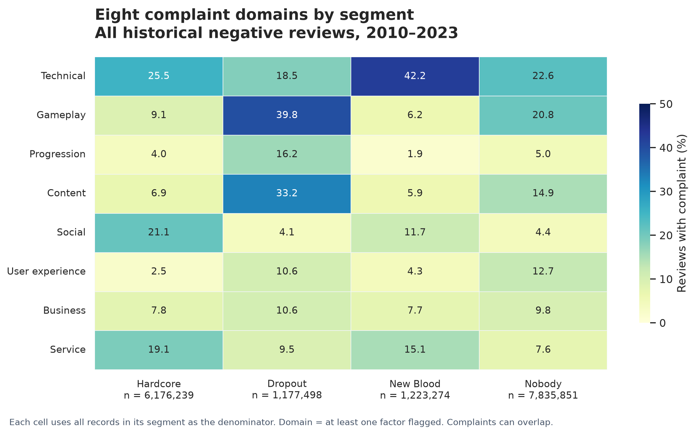
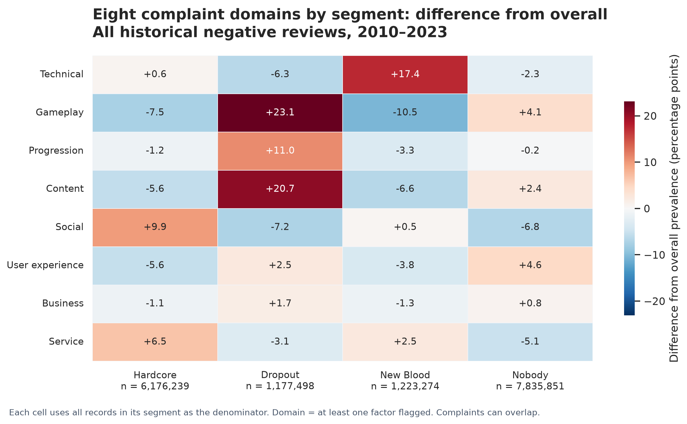
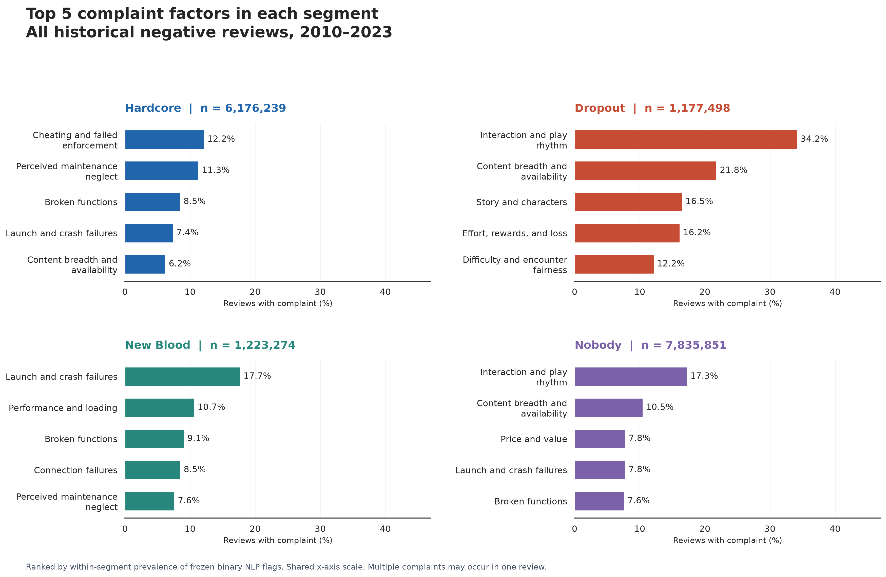
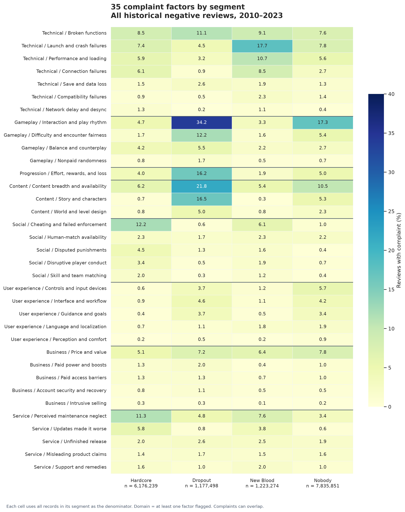
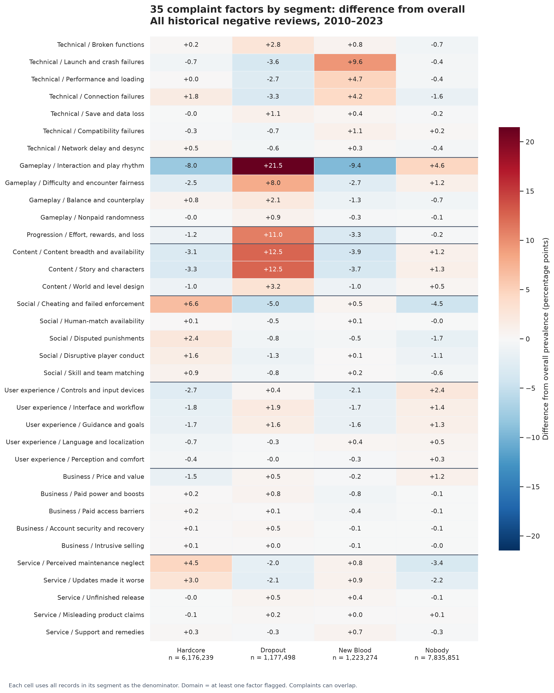
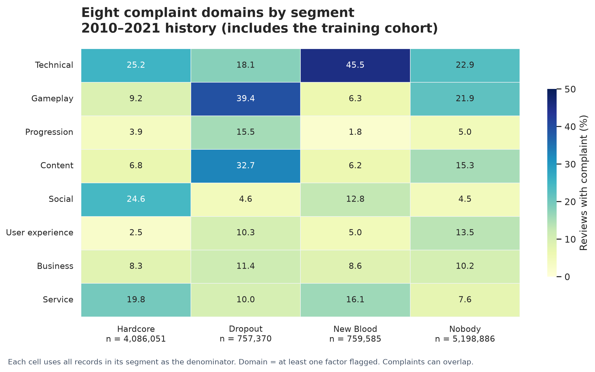
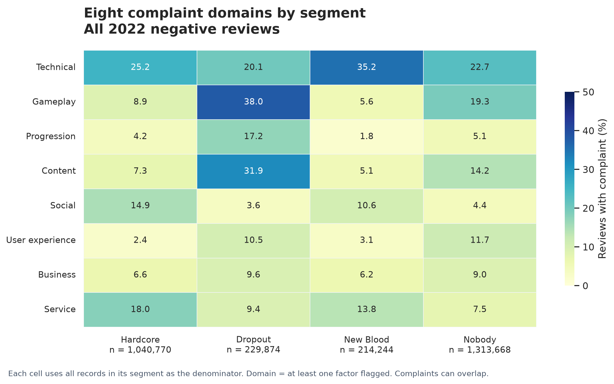

# Complaint profiles of the four P55 review segments

The main analysis covers all 16,412,862 cleaned historical negative-review records, from 2010-10-15 23:40:51+00 to 2023-11-03 15:21:26+00. No training-period records are excluded. The 711,163 records without a binary D30 outcome are also included because segmentation requires model predictions, not observed outcome labels. These are review-level player-game records, not unique players. Separate 2010–2021, 2022, and 2023 summaries show period differences.

## Segmentation and complaint definitions

The frozen LightGBM model and the existing P55/P55 method are extended without retraining or optimizing a new rule. Higher prior engagement means hours at review > 11.78. Higher predicted later engagement means raw prediction >= the period-specific cutoff. The original 4,937,916 validation/test scores, cutoffs, and four-class assignments are preserved exactly. The remaining 11,474,946 records are scored with the same fitted model and its saved 96-feature preprocessing contract.

The added 2010–2021 score cutoff is the 55th percentile of predictions for the original 10,763,783 eligible training records. The frozen 2022 and 2023 cutoffs retain their original eligible validation/test reference cohorts. Unlabeled records receive the cutoff for their review period; they are included in the complaint denominators but do not change these reference cohorts. These are relative score thresholds, so high-score shares in the expanded periods need not equal exactly 45%. Calibration is not refitted; raw probabilities suffice for the original ranking-based segmentation.

| Review period | Raw-score cutoff | Prior-hours cutoff |
| --- | --- | --- |
| 2010–2021 | 0.603875151020 | 11.78 |
| 2022 | 0.563707377961 | 11.78 |
| 2023 | 0.531534888781 | 11.78 |

Hardcore is high/high, Dropout is high/low, New Blood is low/high, and Nobody is low/low. These labels describe model-based profiles and do not establish actual churn or customer value. Training-cohort predictions are in sample, not out-of-fold or independent performance evidence. The all-history figures are retrospective descriptive profiles.

The expanded segmentation table is joined one-to-one to the NLP export using appid and recommendationid. Existing binary flag_ columns are used as supplied. A domain is present if any of its mapped factors is flagged. Each prevalence denominator includes every record in the relevant segment, including records with zero flagged factors. Factors and domains overlap, so percentages do not sum to 100%. Domains contain unequal numbers of retained factors, from one to seven; domain prevalence measures the union of those factors rather than standardized complaint severity.

## Coverage by period and original model eligibility

| Review period | Original model cohort | Records |
| --- | --- | --- |
| 2023 | test | 2,154,782 |
| 2023 | unlabeled | 657,632 |
| 2010–2021 | train | 10,763,783 |
| 2010–2021 | unlabeled | 38,109 |
| 2022 | unlabeled | 15,422 |
| 2022 | val | 2,783,134 |

The model_cohort field is train, val, or test only for records with a binary D30 label in the original time windows; otherwise it is unlabeled. Period-specific figure folders include both eligible and unlabeled records from that period. The split field identifies review period and does not itself establish model eligibility.

## Cohort overview

| Segment | Records | Share | Any complaint flagged | Mean flagged factors |
| --- | --- | --- | --- | --- |
| Hardcore | 6,176,239 | 37.63% | 62.95% | 1.13 |
| Dropout | 1,177,498 | 7.17% | 76.59% | 1.77 |
| New Blood | 1,223,274 | 7.45% | 67.99% | 1.11 |
| Nobody | 7,835,851 | 47.74% | 62.80% | 1.16 |

## Eight complaint domains

Differences use the overall review-weighted prevalence in the same scope as the reference. A positive difference means the complaint is more common in that segment than in the overall cohort. It is a percentage-point difference, not a relative percentage change.

## Top 5 factors by within-segment prevalence

### Hardcore

| Rank | Complaint | Domain | Flagged records | Prevalence | Difference vs overall |
| --- | --- | --- | --- | --- | --- |
| 1 | Cheating and failed enforcement | Social | 750,807 | 12.16% | +6.59 pp |
| 2 | Perceived maintenance neglect | Service | 699,387 | 11.32% | +4.55 pp |
| 3 | Broken functions | Technical | 525,111 | 8.50% | +0.19 pp |
| 4 | Launch and crash failures | Technical | 458,129 | 7.42% | -0.73 pp |
| 5 | Content breadth and availability | Content | 384,880 | 6.23% | -3.08 pp |

The most prevalent domain is Technical (25.48%). The largest positive factor difference from the overall cohort is Cheating and failed enforcement (+6.59 percentage points). The latter is a descriptive contrast, not a causal effect or an additional Top 5 ranking.

### Dropout

| Rank | Complaint | Domain | Flagged records | Prevalence | Difference vs overall |
| --- | --- | --- | --- | --- | --- |
| 1 | Interaction and play rhythm | Gameplay | 402,700 | 34.20% | +21.48 pp |
| 2 | Content breadth and availability | Content | 256,705 | 21.80% | +12.49 pp |
| 3 | Story and characters | Content | 194,583 | 16.53% | +12.53 pp |
| 4 | Effort, rewards, and loss | Progression | 190,305 | 16.16% | +10.98 pp |
| 5 | Difficulty and encounter fairness | Gameplay | 143,336 | 12.17% | +7.96 pp |

The most prevalent domain is Gameplay (39.76%). The largest positive factor difference from the overall cohort is Interaction and play rhythm (+21.48 percentage points). The latter is a descriptive contrast, not a causal effect or an additional Top 5 ranking.

### New Blood

| Rank | Complaint | Domain | Flagged records | Prevalence | Difference vs overall |
| --- | --- | --- | --- | --- | --- |
| 1 | Launch and crash failures | Technical | 216,601 | 17.71% | +9.56 pp |
| 2 | Performance and loading | Technical | 130,327 | 10.65% | +4.74 pp |
| 3 | Broken functions | Technical | 111,009 | 9.07% | +0.76 pp |
| 4 | Connection failures | Technical | 104,258 | 8.52% | +4.24 pp |
| 5 | Perceived maintenance neglect | Service | 93,167 | 7.62% | +0.84 pp |

The most prevalent domain is Technical (42.20%). The largest positive factor difference from the overall cohort is Launch and crash failures (+9.56 percentage points). The latter is a descriptive contrast, not a causal effect or an additional Top 5 ranking.

### Nobody

| Rank | Complaint | Domain | Flagged records | Prevalence | Difference vs overall |
| --- | --- | --- | --- | --- | --- |
| 1 | Interaction and play rhythm | Gameplay | 1,354,236 | 17.28% | +4.56 pp |
| 2 | Content breadth and availability | Content | 819,738 | 10.46% | +1.15 pp |
| 3 | Price and value | Business | 609,652 | 7.78% | +1.15 pp |
| 4 | Launch and crash failures | Technical | 609,475 | 7.78% | -0.37 pp |
| 5 | Broken functions | Technical | 597,629 | 7.63% | -0.69 pp |

The most prevalent domain is Technical (22.59%). The largest positive factor difference from the overall cohort is Interaction and play rhythm (+4.56 percentage points). The latter is a descriptive contrast, not a causal effect or an additional Top 5 ranking.

## All 35 factors

## Historical period comparisons

The main full-history profile weights every record equally. It is not an unweighted average of period rates. Period-specific tables use each period's own segment denominator and overall baseline. The prevalence heatmaps use a shared color scale across periods for each metric type. Factor row order is held constant using all-history prevalence within each domain. The 2010–2021 period aggregates twelve years, whereas 2022 and 2023 are individual years; interpret composition differences accordingly.

Period-specific 35-factor heatmaps and Top 5 charts are in the matching figure folders. CSV tables contain all four scopes: all_history_2010_2023, history_2010_2021, validation_2022, and test_2023. Validation/test names identify the original project time windows; expanded period totals include previously unlabeled records and therefore exceed the archived eligible validation/test counts.

## Interpretation and limitations

- NLP factors are classifier flags rather than human-confirmed labels. Per-factor held-out precision, recall, F1, and positive counts accompany the factor table. Three retained factors have fewer than ten held-out positives: Nonpaid randomness, Intrusive selling, and Account security and recovery. Their accuracy estimates are imprecise.
- NLP predictors contribute to the model used to define the segments. Complaint contrasts between model-defined groups partly reflect that construction and do not independently prove why players stop playing.
- Comparisons are descriptive and review-weighted. They do not adjust for game, language, review date, editing, or other composition differences. No causal effects or significance tests are claimed.
- The historical cohort includes edited reviews. Review edits may occur after the outcome period. The supplied still_playing_d30 field is an open-ended snapshot activity proxy, not a fixed-horizon retention measure. Scores for records missing this field have no observed outcome against which to evaluate them here.
- The eligible 2010–2021 training cohort is profiled using predictions from the model fitted on that cohort. These training-period contrasts can reflect model fit and must not be presented as independent prediction validation. Pooling historical records is appropriate for this descriptive coverage objective, not for estimating held-out predictive performance.
- Final P55 thresholds were selected retrospectively after prior exposure to test results. These profiles are post hoc descriptive analysis, not a new untouched-test validation.

## Verification

The join covers all 16,412,862 cleaned historical records with zero unmatched NLP records. The join keys are unique. All 35 flags are non-null and binary; their sum matches the stored factor count. Every saved label agrees with its numeric decision rules, and all original 4,937,916 validation/test scores and assignments are unchanged.

Independent aggregate verification is recorded in [verification.json](../../results/user_persona/verification.json). Input checksums and the output inventory are recorded in [analysis_manifest.json](../../results/user_persona/analysis_manifest.json). See [User Persona workflow](../../docs/user_persona.md) for reproducible commands. Canonical inputs, trained models, and archived evaluation results are read only during reproduction.
