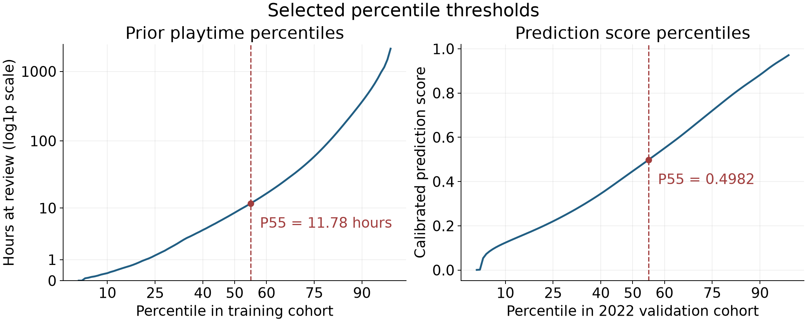
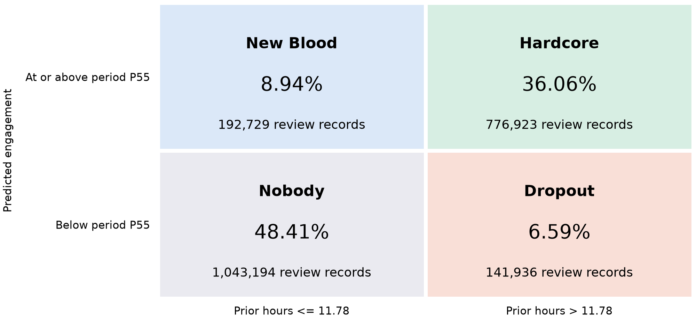

# Percentile Selection and Final Review Segmentation

Team 18 | Final segmentation analysis | 9 October 2026

## Purpose and final decision

We selected the 55th percentile for prior playtime and predicted later engagement to assign negative-review records to Hardcore, Dropout, New Blood and Nobody. This framework supports review prioritization by distinguishing historical investment from expected subsequent participation. Exploratory K-means profiles provide context for these dimensions; explicit percentile rules make the final assignments reproducible.

## Exploratory evidence and the four segment framework

The project’s 16-feature K-means analysis described 13,868,261 unedited negative-review records. Its four clusters differed in prior playtime, observed D30 engagement, review length and complaint domain. Cluster 0 combined the highest median playtime with the highest D30 proxy rate. Cluster 3 combined the lowest values on both measures with the longest reviews. These patterns show why a negative review alone is insufficient to characterize engagement or the detail of feedback.

| K-means cluster | Share | Median prior hours | Observed D30 proxy | Leading complaint domain |
|---|---|---|---|---|
| 0 | 12.6% | 40.7 | 69.7% | Service |
| 1 | 53.9% | 7.6 | 52.4% | Technical |
| 2 | 9.5% | 4.7 | 39.7% | Business |
| 3 | 24.0% | 3.3 | 22.8% | Gameplay |

These exploratory profiles motivate examining prior investment and later engagement together. The project’s two-by-two business framework translates those dimensions into four interpretable combinations, using model predictions for the later-engagement axis. Dropout explicitly captures invested reviewers with lower expected participation, a business-relevant combination without a clearly corresponding standalone K-means cluster. The four-quadrant structure is a design choice; cluster memberships are not mapped directly to the final segments.

Observed still_playing_d30 was itself a K-means input. Consequently, the cluster engagement differences provide descriptive context, not independent validation of prediction or proof that four natural behavioral types exist. K-means also does not determine the percentile cutoffs.

## Threshold selection

We evaluated 121 pairs from P25 to P75 in steps of five. Prior cutoffs used 10,763,783 eligible training records dated 15 October 2010 through 31 December 2021; score cutoffs used 2,783,134 validation predictions from 2022. Selection maximized the smallest of the four validation segment shares to preserve representation of all profiles for subsequent analysis. Actual outcome labels and 2023 records did not enter selection.

P55/P55 achieved the largest minimum share, 7.63%, within this grid. Holding its full-2022 numerical score cutoff fixed, the smallest group represented 7.36% to 7.74% of records across the four quarters. This diagnostic supports coverage over time. The objective expresses an analytical preference for representation; it does not establish business value, predictive accuracy or statistical necessity in a dataset of this size.

## Operational definitions and percentile distributions

Higher prior engagement is defined as hours_at_review > 11.78, the training P55 cutoff. Equality belongs to the lower-prior group. Higher predicted engagement is defined as a score at or above the same-period P55, placing approximately the top 45% of each period in the higher-score group. The percentile policy is held constant, while the numerical score cutoff is calculated separately for 2022 and 2023. This preserves the report’s relative-engagement framework and the final model’s inclusion of edited reviews.

| Segment | Prior playtime | Predicted engagement |
|---|---|---|
| Hardcore | > 11.78 hours | At or above period P55 |
| Dropout | > 11.78 hours | Below period P55 |
| New Blood | At most 11.78 hours | At or above period P55 |
| Nobody | At most 11.78 hours | Below period P55 |

The selected percentiles produce the following period-specific score cutoffs.

| Period | Raw score cutoff | Calibrated score cutoff |
|---|---|---|
| 2022 validation | 0.56370738 | 0.49821669 |
| 2023 test | 0.53153489 | 0.46780342 |

Raw and Platt-calibrated scores produce identical segment assignments for every record. The revised threshold does not change the selected LightGBM with NLP model, its predictions or its calibration. The actual D30 field is used only after assignment to describe the groups. A score cutoff near 0.50 in 2022 is incidental; the rule is a percentile, not a universal 50% probability threshold.

Figure 1. Selected P55 cutoffs in the training playtime and 2022 calibrated-score distributions. The playtime axis uses log1p scaling while displaying original hours.

The curves do not show an obvious natural break at P55. The selected point is justified by the stated coverage criterion and supporting temporal diagnostic, not by a visually discovered discontinuity. Continuous hours and prediction scores are retained in the output so the four labels remain a summary layer rather than replacing the underlying information.

## Final segmentation results

The policy was applied to all 4,937,916 scored negative-review records: 2,783,134 validation records from 2022 and 2,154,782 test records dated 1 January through 5 September 2023. Counts refer to review-level player-game records, not distinct players. Edited reviews are included, consistent with the final model bundle; this cohort differs from the earlier unedited-review OOF and K-means cohorts.

| Segment | 2022 share | 2023 records | 2023 share | 2023 D30 proxy |
|---|---|---|---|---|
| Hardcore | 37.37% | 776,923 | 36.06% | 66.97% |
| Dropout | 8.25% | 141,936 | 6.59% | 21.20% |
| New Blood | 7.63% | 192,729 | 8.94% | 43.56% |
| Nobody | 46.75% | 1,043,194 | 48.41% | 16.17% |

Figure 2. Four review-level segments in the 2023 test cohort under P55/P55. Percentages use all 2,154,782 test records as the denominator.

The 2023 Dropout segment contains 141,936 records (6.59%) with relatively high prior playtime but a score below the period P55. This profile provides a concrete candidate pool for reviewing dissatisfaction among invested players. Hardcore contains 776,923 records (36.06%), New Blood contains 192,729 (8.94%), and Nobody contains 1,043,194 (48.41%). The four groups need not be equal because the two engagement dimensions are associated.

Observed D30 proxy rates are 66.97% for Hardcore, 21.20% for Dropout, 43.56% for New Blood and 16.17% for Nobody. These rates describe the assigned groups; their differences were not used to choose the thresholds and do not establish causal effects or intervention benefits.

## Interpretation and relationship to the project report

The final segmentation connects the project’s exploratory findings to an operational review framework. K-means describes how engagement and complaint characteristics vary; the two-by-two design organizes historical investment and expected participation; the selected percentiles assign each scored record to one of the four profiles. The cluster and segment proportions have different meanings and refer to different cohorts.

Dropout provides a candidate pool for examining dissatisfaction among relatively invested players. Hardcore allows the team to investigate complaints from invested players who may continue participating. New Blood highlights lower-investment records with relatively high predicted participation, while Nobody captures lower values on both dimensions. Comparing complaint themes within these final segments is a useful next analysis. The K-means complaint profiles cannot be transferred to them without measuring the new groups directly.

## Limitations

This is a retrospective segmentation revision: the original 2023 results had already been reviewed before the present analysis. The selection code uses only training playtime and 2022 scores, but this work should not be described as a new untouched prospective test. The quarterly diagnostic also reuses 2022 data and is supporting evidence rather than an independent validation study.

P55/P55 is the best pair under the stated minimum-coverage objective within the tested grid. It is not established as a global optimum, a Steam-specific behavioral boundary or a business-optimal intervention threshold. A different objective could select a different pair. Historical playtime above 11.78 hours indicates relative investment, not verified veteran status; Dropout does not prove actual churn, and Nobody does not imply that feedback lacks value. No category identifies spam or abuse.

The same-period ranking policy places approximately 45% of each batch in the higher-score group. Its size therefore cannot measure overall engagement change across years, and the policy is not directly a fixed threshold for one newly arriving review. A deployment decision would require a defined intervention, processing capacity, costs and benefits, followed by appropriate independent evaluation.

The supplied still_playing_d30 field remains an observed engagement proxy subject to the original unequal-follow-up concern. Neither Platt scaling nor percentile segmentation corrects censoring or establishes a uniform 30-day observation window. Consequently, the reported proxy rates should not be labeled independently validated 30-day retention rates. The model and target construction were not revalidated by this segmentation exercise.

## Reproducibility

The delivery includes executable selection and assignment code, the 121 candidate results, exact cutoffs, quarterly diagnostics and record-level segment labels. All 4,937,916 assignments were independently verified and all original prediction fields were preserved. The K-means profile statistics are taken from the saved EDA.ipynb outputs; this analysis does not refit the clustering or the predictive model.

Methodological context: Altman and Royston (BMJ, 2006, doi:10.1136/bmj.332.7549.1080) describe the information loss and interpretive limits of dichotomizing continuous variables. This supports retaining continuous scores and limiting claims; it does not prescribe P55. Scikit-learn’s guidance on decision-threshold tuning likewise emphasizes that the appropriate threshold depends on the intended objective.

